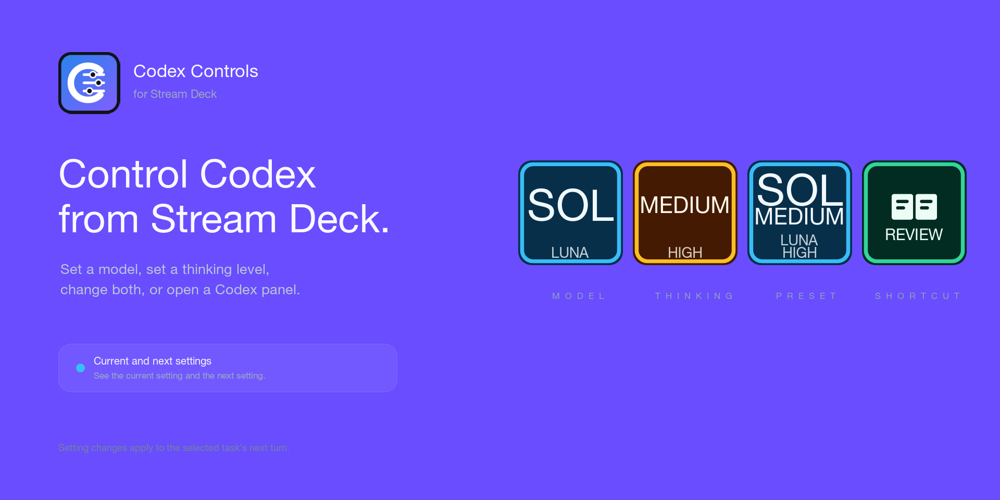

# Codex Controls for Stream Deck

Codex Controls lets you change the model and thinking level of the selected
local Codex task from Stream Deck. It also opens common Codex panels and shows
the current values for local and remote tasks on macOS.



## What it does

- Use **Model** to change only the model.
- Use **Thinking** to change only the thinking level.
- Use **Preset** to change the model and thinking level together.
- Use **Shortcut** to open Review, Terminal, Browser, Files, or Side chat.
- Add one value to make a direct Model, Thinking, or Preset key.
- Add two or more values to a setting key to cycle through them in your chosen
  order.
- See the current value and the next value on each setting key.
- Use 16 included color presets or save shared custom color presets.


A successful local change applies to the selected task's next turn. It does
not change a response that Codex is already generating.

## Requirements

- macOS 12 or later.
- Codex desktop or T3 Code.
- Elgato Stream Deck 7.1 or later.
- Node.js 24 for development.

## Configure a key

1. Drag Model, Thinking, Preset, or Shortcut from **Codex Controls** to a key.
2. Select the key in Stream Deck.
3. For Model, Thinking, or Preset, add the values in the order that you want.
4. Set a short label and a color for each value.
5. Choose whether the key shows its title. Setting keys can also show the next
   value.

Use Codex model identifiers such as `gpt-5.6-sol`. Use thinking values such as
`medium`, `high`, or `xhigh`.

For a Shortcut key, select the one Codex shortcut that the key opens.

If the current Codex value is not in the configured list, the key uses a gray
color scheme. The first press then selects the first configured value.

## Local and remote tasks

The plug-in detects the selected task through Codex desktop. It shows current
next-turn settings for local and remote tasks. Remote setting changes are
disabled because this Codex release does not provide a reliable remote composer
update route. It does not add user-facing host settings.

The Codex desktop interfaces used for task control can change between releases.
This plug-in contains a compatibility layer for these interfaces. A Codex
desktop update can require a plug-in update.

Remote task detection and setting controls use Codex desktop IPC. They do not
use Accessibility, Screen Recording, OCR, or UI clicks.

Shortcut keys activate Codex and use its standard keyboard commands. These
keys use macOS Accessibility for keyboard input. macOS can ask you to allow
Stream Deck to control keyboard input. If you changed a Codex keyboard command,
restore its standard value before you use the related key.

Codex desktop side chats use their parent task. The key shows the parent task
settings while a side chat is open. It changes these settings for a local
parent task. See
[side-chat support](docs/side-chat-support.md) for the current compatibility
status and the retest procedure.

## T3 Code

The keys also control T3 Code. The keys follow the last app that you brought to
the front: Codex desktop or T3 Code.

- Model, Thinking, and Preset keys read and change the model and thinking level
  in the composer of the open T3 Code thread. This includes a new thread that
  you did not send yet, and a thread in a linked or remote environment.
- A change applies to the next message of the thread.
- Use model identifiers such as `gpt-6.2-sol` or `claude-opus-5-5`. The key
  matches them with the names in the T3 Code model picker, such as
  "GPT-6.2-Sol" or "Claude Opus 5.5".
- Shortcut keys open Review (diff), Terminal, Browser (preview), and Files. They
  use your T3 Code key bindings. T3 Code has no side chat.

The plug-in uses only the T3 Code window on this Mac. It reads the model button
of the composer and selects items in the model picker through macOS
Accessibility. It does not connect to a T3 Code server. Allow Stream Deck in
**System Settings > Privacy & Security > Accessibility**. Without this
permission, the keys show **ALLOW ACCESS**.

A key press opens the T3 Code model picker for about one second. A T3 Code
update that changes the composer can require a plug-in update.

## Install a release

Open the released `.streamDeckPlugin` file. Stream Deck installs the plug-in.

## Development

Install the dependencies:

```sh
npm install
```

Enable Stream Deck developer mode and link the plug-in once:

```sh
npx streamdeck dev
npx streamdeck link com.courcelle.codex-controls.sdPlugin
```

Start the development build:

```sh
npm run watch
```

Run the quality checks:

```sh
npm run format:check
npm run lint
npm test
npm run typecheck
npm run build
npm run validate
```

Update the README and marketplace images after a key or property inspector
change:

```sh
npm run generate:readme-images
```

The command uses the actual key renderer, default settings, property inspector
HTML, property inspector CSS, and property inspector JavaScript. It requires
ImageMagick and Chrome, Chromium, or Edge. See the
[publication guide](docs/publishing.md) for browser setup details.

The main code areas are:

- `src/actions/` for Stream Deck actions.
- `src/apps/` for the frontmost-app watcher and the app router.
- `src/codex/` for Codex task access and Shortcut keys.
- `src/t3code/` for T3 Code thread access.
- `src/domain/` for settings and color definitions.
- `src/ui/` for key rendering.
- `com.courcelle.codex-controls.sdPlugin/` for the manifest, property inspector,
  and runtime assets.

See the [publication guide](docs/publishing.md) before a release. It explains
the publication files and the package command. Do not run the package command
until the release is ready.

## Support and privacy

Read [SUPPORT.md](SUPPORT.md) to report a problem and review the data-use
statement. Codex Controls has no analytics and no advertising.

## License

Codex Controls is available under the [MIT License](LICENSE).
