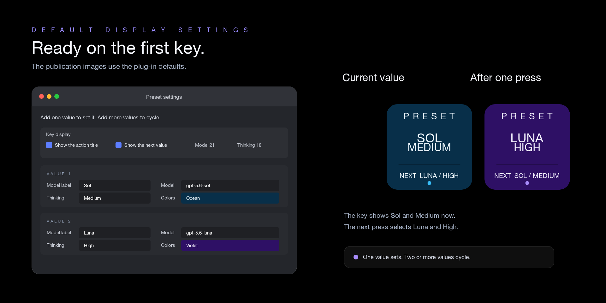

# Codex Controls for Stream Deck

Codex Controls lets you change the model and thinking level of the selected
local Codex task from Stream Deck. It also shows the current values for local
and remote tasks on macOS.


## What it does

- Use **Model** to change only the model.
- Use **Thinking** to change only the thinking level.
- Use **Preset** to change the model and thinking level together.
- Add one value to make a direct set key.
- Add two or more values to cycle through them in your chosen order.
- See the current value and the next value on the key.
- Use 16 included color presets or save shared custom color presets.



A successful local change applies to the selected task's next turn. It does
not change a response that Codex is already generating.

## Requirements

- macOS 12 or later.
- Codex desktop.
- Elgato Stream Deck 7.1 or later.
- Node.js 24 for development.

## Configure a key

1. Drag Model, Thinking, or Preset from **Codex Controls** to a key.
2. Select the key in Stream Deck.
3. Add the values in the order that you want.
4. Set a short label and a color for each value.
5. Choose whether the key shows its title and next value.

Use Codex model identifiers such as `gpt-5.6-sol`. Use thinking values such as
`medium`, `high`, or `xhigh`.

If the current Codex value is not in the configured list, the key uses a gray
color scheme. The first press then selects the first configured value.

## Local and remote tasks

The plug-in detects the selected task through Codex desktop. It shows current
next-turn settings for local and remote tasks. Remote setting changes are
disabled because this Codex release does not provide a reliable remote composer
update route. It does not add user-facing host settings.

The Codex desktop interfaces used for task control can change between releases.
This plug-in contains a compatibility layer for these interfaces. A Codex
desktop update can require a plug-in update.

Remote task detection and display use Codex desktop IPC. The plug-in does not
use Accessibility, Screen Recording, OCR, or UI clicks.

Codex desktop side chats use their parent task. The key shows the parent task
settings while a side chat is open. It changes these settings for a local
parent task. See
[side-chat support](docs/side-chat-support.md) for the current compatibility
status and the retest procedure.

## Install a release

Open the released `.streamDeckPlugin` file. Stream Deck installs the plug-in.

No public release package is available yet. The plug-in is still in active
development.

## Development

Install the dependencies:

```sh
npm install
```

Enable Stream Deck developer mode and link the plug-in once:

```sh
npx streamdeck dev
npx streamdeck link com.courcelle.codex-controls.sdPlugin
```

Start the development build:

```sh
npm run watch
```

Run the quality checks:

```sh
npm run format:check
npm run lint
npm test
npm run typecheck
npm run build
npm run validate
```

The main code areas are:

- `src/actions/` for Stream Deck actions.
- `src/codex/` for Codex task access.
- `src/domain/` for settings and color definitions.
- `src/ui/` for key rendering.
- `com.courcelle.codex-controls.sdPlugin/` for the manifest, property inspector,
  and runtime assets.

See the [publication guide](docs/publishing.md) before a release. It explains
the publication files and the package command. Do not run the package command
until the release is ready.

## Support and privacy

Read [SUPPORT.md](SUPPORT.md) to report a problem and review the data-use
statement. Codex Controls has no analytics and no advertising.

## License

Codex Controls is available under the [MIT License](LICENSE).
